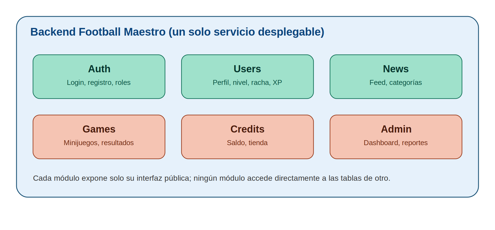
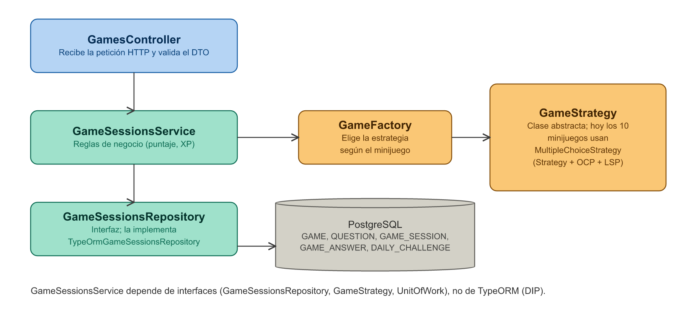
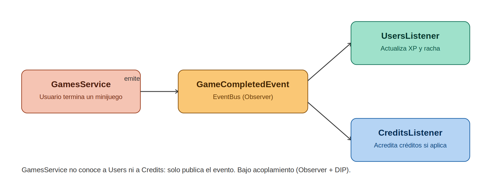
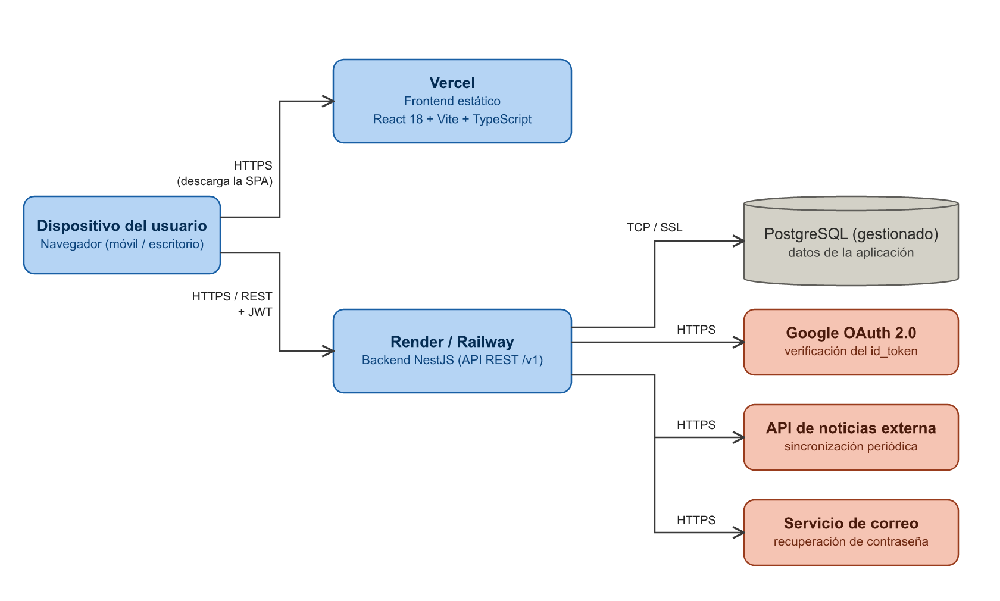

**FOOTBALL MAESTRO**

*Become a Football Maestro*

**DOCUMENTO DE ARQUITECTURA DE SOFTWARE**

Diseño de la arquitectura lógica y física del sistema

(Backlog del Proyecto — Tablero Trello “Football Maestro”)

Fecha de elaboración: 23 de septiembre de 2026

Fecha de actualización: 27 de septiembre de 2026

Versión: 2.0

---

## 1. Introducción

Este documento define la arquitectura de software del backend de “Football Maestro”, complementando el Documento de Requisitos Funcionales y No Funcionales (v2) y el tablero de historias de usuario del proyecto en Trello. El frontend (React 18 + TypeScript + Vite + Tailwind CSS) es una aplicación web responsiva (se usa desde el navegador en escritorio, tableta o celular); este documento se centra en el backend que da soporte real a sus 16 pantallas:

- Acceso (4): SplashScreen, WelcomeScreen, SignInScreen, RegisterScreen.
- Jugador (6, con una barra superior de 5 secciones: Home, Games, News, Credits, Profile): MainHomeScreen, MinigamesScreen, ResultsScreen, NewsScreen, CreditsScreen, ProfileScreen.
- Administrador (6, con la barra superior del portal): AdminDashboardScreen, AdminUsersScreen, AdminGamesScreen, AdminEconomyScreen, AdminAnalyticsScreen, AdminReportsScreen.

El objetivo es establecer un estilo arquitectónico, una organización modular del código, los patrones de diseño aplicables a cada módulo, cómo se materializan los principios SOLID en la implementación y cómo se despliega físicamente el sistema.

Alcance: el módulo “Partidos y Estadísticas” (calendario y resultados en vivo) mencionado en el documento de Requisitos, Arquitectura y UML del 19 de septiembre no tiene ninguna pantalla en el sistema actual y queda fuera de alcance como trabajo futuro (ver sección 10).

## 2. Objetivo del documento

Establecer, de manera formal y trazable, el diseño arquitectónico del sistema (estilo arquitectónico, módulos, capas, patrones de diseño, principios SOLID y vista de despliegue) que servirá como base para la implementación del backend, garantizando bajo acoplamiento, alta cohesión y facilidad de mantenimiento y extensión.

## 3. Estilo arquitectónico

Se adopta un monolito modular por dominios: el backend se despliega como una única aplicación, pero el código está organizado en módulos independientes por dominio de negocio, cada uno con su propia lógica interna y comunicándose con los demás solo a través de interfaces públicas bien definidas (nunca accediendo directamente a las tablas de otro módulo).

Interfaces públicas entre módulos (lo único que un módulo puede importar de otro). Son clases abstractas pequeñas, una por consumidor, que devuelven objetos de lectura propios (UserAccount, PlayerSummary) y nunca la entidad de base de datos:

| Módulo | Interfaz pública | Quién la usa y para qué |
| --- | --- | --- |
| Users | UserAccounts | Auth: buscar y crear cuentas, vincular Google y cambiar la contraseña. |
| Users | CreditBalanceStore | Credits: leer y mover el saldo de créditos. |
| Users | PlayerDirectory, UsersStatsReader | Admin: gestionar jugadores (buscar, suspender, eliminar) y métricas de registros, actividad y retención. |
| Users | PlayersBreakdownReader | Admin: cómo se reparten los jugadores (país, método de registro, nivel e insignias). |
| Games | PlayerGameStatsReader | Users: resumen de partidas de un jugador (perfil, precisión, insignias). |
| Games | GamesStatsReader | Admin (Dashboard, Analytics y Reportes): métricas generales de partidas, categorías y ranking. |
| Games | GameInsightsReader | Admin (pantalla Minijuegos): rendimiento por minijuego, puntajes, preguntas más difíciles, reto diario e idioma. |
| Games | GamesByPlayerReader | Admin: partidas de jugadores concretos (“Ver perfil” y embudo de activación). |
| Credits | CreditsStatsReader | Admin: créditos ganados, gastados y en circulación, y compras de la tienda. |
| Auth | Decoradores @CurrentUser, @Public, @Roles y @PlayerOnly | Todos los controladores. |
| News, Admin | Ninguna: solo reaccionan a eventos o atienden sus propias pantallas | — |

Los enums de rol y estado (users/user.enums) son vocabulario compartido. La entidad USER solo la importan otras entidades, para sus llaves foráneas.

Las dependencias entre módulos no forman ciclos: Auth → Users → Games; Credits → Users; Admin → Users, Games y Credits. Games no depende de ningún otro módulo de dominio. Estas reglas se verifican automáticamente en la suite de pruebas (src/architecture.spec.ts): falla si un servicio importa el ORM, si un módulo importa de otro algo que no sea una de estas interfaces (o si una de ellas deja de ser abstracta), si otro módulo usa la entidad USER fuera de una llave foránea o si aparece una dependencia circular.

### 3.1 Comparación de alternativas evaluadas

| Alternativa | Ventajas | Por qué no se eligió / se eligió |
| --- | --- | --- |
| Monolito simple (sin módulos) | Muy rápido de iniciar | En cuanto el proyecto crece (14 pantallas, panel admin de 4 pantallas) se acopla todo y viola SOLID fácilmente. |
| Microservicios desde el inicio | Escalabilidad y despliegue independiente por dominio | Añade complejidad de infraestructura (orquestación, red, consistencia entre servicios) injustificada para el tamaño actual del proyecto y del equipo. |
| Monolito modular por dominios (elegido) | Un solo despliegue simple, código desacoplado por dominio, fácil de extraer un módulo a microservicio en el futuro si se necesita | Es el punto de equilibrio adecuado para el tamaño y la etapa actual del proyecto. |

### 3.2 Diagrama general de módulos



### 3.3 Módulos del sistema

| Módulo | Responsabilidad | Pantallas relacionadas (Trello) |
| --- | --- | --- |
| Auth | Login y registro con correo/contraseña, autenticación con Google (OAuth 2.0), refresh tokens, cierre de sesión, recuperación de contraseña y gestión de roles Player/Admin. | WelcomeScreen, SignInScreen, RegisterScreen (SplashScreen verifica la sesión) |
| Users | Perfil, nivel, racha, XP, precisión, insignias, configuración de cuenta y registro de la actividad de uso (USER_SESSION) que alimenta la analítica. | ProfileScreen, MainHomeScreen (header y “My Stats”) |
| News | Sincronización periódica de la API de noticias externa, feed y filtrado por categoría. | NewsScreen, MainHomeScreen (vista previa) |
| Games | Catálogo de minijuegos, preguntas, reto diario, lógica de cada juego, cálculo de resultados y datos curiosos. | MinigamesScreen, ResultsScreen, MainHomeScreen (reto diario y vista previa) |
| Credits | Saldo de créditos, formas de ganarlos, tienda de canje e ítems aplicados al perfil. | CreditsScreen |
| Admin | Dashboard, gestión de usuarios, analítica, reportes y registro de auditoría. Consulta a Users, Games y Credits solo a través de sus interfaces públicas. | AdminDashboardScreen, AdminUsersScreen, AdminAnalyticsScreen, AdminReportsScreen, AdminGamesScreen, AdminEconomyScreen |

## 4. Arquitectura en capas por módulo

Cada uno de los 6 módulos sigue internamente la misma estructura en capas, ilustrada a continuación con el módulo Games como ejemplo (la misma estructura aplica a Auth, Users, News, Credits y Admin):



| Capa | Responsabilidad |
| --- | --- |
| Controller | Recibe la petición HTTP, valida el DTO de entrada y delega al Service. No contiene lógica de negocio. |
| Service | Contiene las reglas de negocio del dominio. Orquesta repositorios, estrategias y eventos. Solo depende de interfaces: nunca importa TypeORM. |
| Repository | Interfaz (clase abstracta, p. ej. GameSessionsRepository) con las operaciones de datos que necesita el dominio. Su implementación con TypeORM (TypeOrmGameSessionsRepository) es la única clase que conoce el ORM; el módulo conecta una con otra. |
| Entity / DB | Modelo de persistencia (entidades TypeORM) y almacenamiento real de los datos en PostgreSQL. Ver Documento de Modelo de Datos. |

Transacciones: cuando varias escrituras deben confirmarse juntas (cerrar una partida, comprar en la tienda, sumar XP), el servicio las envuelve en UnitOfWork.run(). Los repositorios usados dentro participan automáticamente en la transacción, sin que ningún módulo le pase a otro un objeto del ORM. Para procesar de a una las operaciones de un mismo jugador, cada módulo usa su propio candado (lockPlayer en Games, lockAccount en Credits) en lugar de bloquear filas de tablas ajenas.

Fecha y zona horaria: AppClock (shared/time) da la fecha de hoy en APP_TIMEZONE y la zona para las consultas. Es el único lugar que lee esa variable; el reto diario, la racha y las métricas del panel lo usan para cambiar de día a la medianoche de la app.

## 5. Comunicación entre módulos: eventos de dominio

Para evitar que los módulos se llamen directamente entre sí (acoplamiento fuerte), la comunicación entre dominios se realiza mediante eventos. Ejemplo: al completar un minijuego, Games no conoce ni llama a Users ni a Credits directamente — publica un evento que cada módulo interesado escucha por su cuenta.



Eventos de dominio definidos:

| Evento | Emisor | Qué hacen los módulos que lo escuchan |
| --- | --- | --- |
| GameCompletedEvent | Games | Users: suma XP, recalcula nivel, precisión y racha, y otorga insignias. Credits: +50 si la partida era el reto diario (una vez por día). |
| StreakReachedEvent | Users | Credits: +100 al alcanzar una racha de 7 días. |
| ResultSharedEvent | Games | Credits: +25 por compartir un resultado (una vez por partida). |
| UserRegisteredEvent | Auth | Credits: +200 al usuario que lo refirió, si existe. (La cuenta y el perfil los crea Auth antes, llamando a UsersService, porque necesita el id del usuario para iniciar la sesión.) |
| ItemPurchasedEvent | Credits | Users: otorga la insignia Coleccionista con la primera compra. |
| PasswordChangedEvent | Users | Auth: cierra todas las sesiones del usuario. |
| UserSuspendedEvent | Admin | Auth: cierra todas las sesiones del usuario suspendido. |
| AdminActionEvent | Admin, Auth | Admin: guarda el registro en ADMIN_AUDIT_LOG (login de administrador, suspender, activar, eliminar, exportar). |

## 6. Patrones de diseño aplicados

Cada patrón se seleccionó para resolver un problema concreto identificado en las historias de usuario del tablero, no de forma genérica.

| Patrón | Módulo(s) | Problema que resuelve |
| --- | --- | --- |
| Repository | Todos | Separa la lógica de negocio de cómo se persisten los datos; el Service depende de una interfaz de repositorio y nunca de un motor de base de datos concreto. |
| Unit of Work | Todos | Agrupa en una sola transacción las escrituras de varios repositorios sin que el Service conozca el ORM. |
| Strategy | Games | Las reglas de validación y puntaje de cada minijuego viven en una estrategia (clase abstracta GameStrategy) en vez de un condicional gigante: MultipleChoiceStrategy (con el estilo visual de cada minijuego de selección), ConnectionsStrategy, TimelineStrategy, ValueGuessStrategy (margen del 10 %) y VarStrategy. En el frontend, cada estilo tiene su propia vista, registrada en playStyles.ts. |
| Factory Method | Games | GameFactory decide qué estrategia instanciar según el strategy_key del minijuego elegido, sin acoplar ese conocimiento al resto del módulo. |
| Observer (eventos de dominio) | Games, Users, Auth, Credits, Admin → Users, Credits, Auth, Admin | Al completar un minijuego, compartir un resultado o registrarse, varios módulos reaccionan (XP, racha, créditos, auditoría) sin que el emisor los conozca directamente. |
| Adapter | Auth (Google OAuth, correo), News (API externa) | Aísla librerías/API externas detrás de una interfaz propia; cambiar de proveedor solo afecta al adapter. |
| DTO (Data Transfer Object) | Todos | El contrato HTTP nunca expone directamente el modelo de base de datos (p. ej. password_hash o correct_answer). |
| Facade | Admin → Dashboard / Analytics / Reports / Games / Economy | AdminDashboardService, AdminAnalyticsService, AdminReportsService, AdminGamesService y AdminEconomyService reúnen datos de Users, Games y Credits a través de sus interfaces públicas de estadísticas (UsersStatsReader, PlayersBreakdownReader, GamesStatsReader, GameInsightsReader, GamesByPlayerReader y CreditsStatsReader), sin consultar sus tablas directamente. Cada servicio depende solo de las interfaces que usa. |

## 7. Principios SOLID aplicados

| Principio | Aplicación concreta en Football Maestro |
| --- | --- |
| S — Single Responsibility | AuthService solo autentica; la actualización del perfil es responsabilidad de ProfileService; en Admin, AdminUsersService gestiona jugadores y CsvReportExportService solo exporta. |
| O — Open/Closed | Gracias a GameStrategy, agregar un minijuego con reglas nuevas no modifica GameSessionsService: solo se crea una nueva estrategia y se registra en GameFactory (RNF-MANT-01). Igual con los repositorios: cambiar de ORM es escribir otras implementaciones. |
| L — Liskov Substitution | Cualquier estrategia debe poder sustituir a otra sin romper GameSessionsService (mismo contrato para validar y puntuar); cualquier implementación de un repositorio (TypeORM o en memoria para pruebas) cumple el mismo contrato. |
| I — Interface Segregation | En Admin se separan IUserManagement (consultar, suspender, activar, eliminar) de IReportExport (exportar CSV). Entre módulos, cada consumidor recibe solo lo que usa: Auth depende de UserAccounts, Credits de CreditBalanceStore, Users de PlayerGameStatsReader y Admin de PlayerDirectory, UsersStatsReader, PlayersBreakdownReader, GamesStatsReader, GameInsightsReader, GamesByPlayerReader y CreditsStatsReader, nunca de servicios completos. Las interfaces de estadísticas se dividen por uso: la pantalla Minijuegos no depende de los métodos de “Ver perfil”, ni al revés. |
| D — Dependency Inversion | Los servicios dependen de interfaces (GameSessionsRepository, UnitOfWork, UserAccounts, PlayerDirectory…), nunca de TypeORM ni de clases concretas de otro módulo; el módulo de NestJS decide qué implementación inyectar. Así se prueba la lógica con repositorios en memoria (p. ej. store.service.spec.ts) sin base de datos. |

## 8. Stack tecnológico y estructura de carpetas

### 8.1 Stack tecnológico

| Capa | Tecnología | Justificación |
| --- | --- | --- |
| Frontend | React 18 + TypeScript, Vite, Tailwind CSS, Recharts, Motion, i18next | Es el stack del frontend ya construido (16 pantallas, aplicación web responsiva). Se despliega como sitio estático. |
| Backend | Node.js + NestJS + TypeScript | Comparte lenguaje con el frontend y su arquitectura está construida nativamente alrededor de Inyección de Dependencias, módulos y decoradores, lo que facilita demostrar SOLID y los patrones anteriores de forma explícita. |
| Base de datos | PostgreSQL + TypeORM | Modelo relacional para usuarios, partidas, créditos y actividad; consultas parametrizadas vía ORM (Plan de Seguridad, A03). |
| Autenticación | JWT de acceso + refresh token (cookie httpOnly), bcrypt, Google OAuth 2.0 | Roles diferenciados Player/Admin validados en el backend (RNF-SEC-03) e invalidación real de sesión (RNF-SEC-05). |
| Servicios externos | Currents API (noticias; plan gratuito de 250 peticiones/día, sin retraso), Google OAuth 2.0, Brevo (correo transaccional; plan gratuito de 300 correos/día) | Consumidos siempre a través de Adapters (sección 6). |
| Hosting | Vercel (frontend), Render o Railway (backend y PostgreSQL gestionado) | Planes gratuitos suficientes para el prototipo académico. |

Redis y WebSockets (Socket.IO), propuestos en el documento del 19 de septiembre para resultados de partidos en vivo, no son necesarios en el alcance actual: ninguna de las 14 pantallas muestra datos en tiempo real. Se reconsiderarán si se implementa el módulo futuro de Partidos y Estadísticas.

### 8.2 Estructura de carpetas (NestJS)

```
backend/
├── src/
│   ├── <modulo>/                 (misma estructura en los 6 módulos)
│   │   ├── <modulo>.controller.ts
│   │   ├── <nombre>.service.ts   (reglas de negocio; solo interfaces)
│   │   ├── repositories/         (<nombre>.repository.ts = interfaz,
│   │   │                          typeorm-<nombre>.repository.ts = implementación)
│   │   ├── entities/  dto/
│   │   └── <modulo>.module.ts    (conecta interfaz → implementación)
│   ├── auth/      (+ guards/, adapters/ de Google y correo)
│   ├── users/     (+ progress.listener.ts; interfaces públicas user-accounts.ts,
│   │               credit-balance.store.ts, player-directory.ts, users-stats.reader.ts)
│   ├── news/      (+ providers/ Currents y ejemplo, sincronización)
│   ├── games/     (+ strategies/; interfaces públicas player-game-stats.reader.ts,
│   │               games-stats.reader.ts)
│   ├── credits/   (+ credits.listener.ts; interfaz pública credits-stats.reader.ts)
│   ├── admin/     (una carpeta por pantalla con su controlador y su servicio: dashboard/,
│   │               users-management/, analytics/, reports/, games-insights/, economy/;
│   │               audit/; period.ts = período 7/30/90 días; admin-http.ts)
│   ├── shared/    (database/ UnitOfWork, events/, time/ AppClock, i18n/ idioma de la petición, csv)
│   ├── architecture.spec.ts   (verifica las reglas de dependencias)
│   └── app.module.ts
├── test/          (pruebas e2e contra PostgreSQL)
└── package.json
```

Frontend del panel de administración (project/src/app/components/admin): charts/ es el kit de gráficas, una pieza por archivo (ChartCard, PeriodSelector, ColumnChart y TrendChart sobre Recharts; BarList, StackedBarList, Heatmap, Funnel y Sparkline en HTML/CSS; paleta validada para daltonismo); data/ tiene un hook por pantalla que consulta la API y deja los datos listos para dibujar (useGamesInsights, useEconomy, useAnalytics); StatRow, KpiTile y UserDetailPanel son piezas comunes. Así cada pantalla solo compone tarjetas. Cada gráfica muestra la pregunta que responde, un estado vacío y su tabla (“Ver tabla”). Requisitos RNF-UI-094 a RNF-UI-099.

Estructura web del frontend (project/src/app/components/layout): PlayerLayout y AdminLayout ponen la barra superior (TopNav) con las secciones del jugador o las 6 del portal, y centran el contenido con un ancho máximo; AuthLayout divide las pantallas de acceso en un panel de presentación y el formulario; PageHeader es el título de cada página con sus acciones y el enlace “atrás” de las subpáginas. Las cuadrículas cambian de columnas según el ancho (Tailwind: sm, md, lg). La partida (GamePlayScreen) es la única pantalla sin barra: es un modo enfocado. Requisitos RNF-UI-100 a RNF-UI-107.

### 8.3 Idiomas: inglés y español

La aplicación está en inglés (idioma por defecto) y español. El idioma lo elige el jugador con el selector EN | ES (pantalla de bienvenida y Account Settings) y se recuerda en el navegador. La traducción se reparte así, sin que ningún módulo dependa de otro para ello:

| Parte | Cómo se traduce |
| --- | --- |
| Textos de las pantallas (frontend) | i18next + react-i18next. Cada texto es una clave (t("credits.title")) y sus traducciones viven en src/app/i18n/en.json y es.json. Números, fechas, países y “hace X minutos” usan el formato del idioma (Intl). |
| Errores de la API | El backend responde siempre en inglés (mensajes estables, útiles también para registros y pruebas). El frontend los traduce con el mapa src/app/i18n/apiErrors.ts; un mensaje desconocido se muestra tal cual. |
| Idioma de cada petición | El cliente envía la cabecera Accept-Language. En el backend, shared/i18n/locale.ts ofrece el decorador @RequestLocale() (lee la cabecera; si el idioma no se reconoce, inglés) y la función pura localize(registro, idioma). |
| Contenido de la base de datos (minijuegos, preguntas, datos curiosos, tienda) | Cada registro guarda su texto original y, en la columna translations (jsonb), el otro idioma (Modelo de Datos §4). El servicio aplica localize() antes de responder. |
| Partidas | GAME_SESSION.locale fija el idioma al iniciar. GameSessionsService entrega a la estrategia la pregunta ya en ese idioma, así que las estrategias (Strategy) no saben de idiomas y no cambiaron. |
| Noticias | No se traducen: el NewsProvider trae noticias escritas en cada idioma (Currents con palabras clave y filtro de relevancia por idioma) y el feed muestra las del idioma del jugador (NEWS_ARTICLE.language). |
| Correo de recuperación | Sale en el idioma en que se pidió. El contenido (auth/adapters/password-reset-email.ts) está separado del adapter de Brevo, que solo envía. |
| Panel administrativo | Las alertas llegan con code y values (además del mensaje en inglés) y el frontend las traduce; el ranking devuelve el nombre del minijuego en el idioma pedido. |

SOLID: la traducción está en un solo lugar por capa (Single Responsibility); agregar un idioma es agregar su archivo de textos, su clave en translations y su código en LOCALES, sin modificar servicios ni estrategias (Open/Closed); shared/i18n no depende de ningún módulo de dominio y no importa el ORM, por lo que la prueba de arquitectura sigue verificando las mismas 7 reglas.

## 9. Vista física (despliegue)

El siguiente diagrama muestra cómo se distribuyen físicamente los componentes. El navegador descarga el frontend estático desde Vercel y consume la API REST del backend directamente; solo el backend se comunica con la base de datos y con los servicios externos.



| Nodo | Contenido | Comunicación |
| --- | --- | --- |
| Dispositivo del usuario | Navegador web (escritorio, tableta o celular) | HTTPS hacia Vercel (descarga de la SPA) y hacia la API (/v1, con JWT). |
| Vercel | Frontend React + Vite compilado (archivos estáticos) | Solo sirve archivos; no accede a datos. |
| Render / Railway | Backend NestJS (monolito modular) | TCP/SSL hacia PostgreSQL; HTTPS hacia Google, la API de noticias y el servicio de correo. |
| PostgreSQL gestionado | Las 16 entidades del Modelo de Datos | Solo accesible desde el backend (credenciales en variables de entorno). |
| Servicios externos | Google OAuth 2.0, Currents API (noticias), Brevo (correo transaccional) | Consumidos mediante Adapters; un fallo de Google no bloquea el login con correo (RNF-DISP-02). |

## 10. Consideraciones finales

Esta arquitectura debe evolucionar junto con el tablero de historias de usuario en Trello. Cualquier módulo que crezca significativamente en autonomía y volumen de datos (por ejemplo Games o Admin) es candidato, en una etapa posterior, a extraerse como microservicio independiente, dado que ya está diseñado con bajo acoplamiento hacia el resto del sistema.

Trabajo futuro: el módulo “Partidos y Estadísticas” (calendario, resultados en vivo y estadísticas de equipos a partir de API-Football o football-data.org) se agregaría como un séptimo módulo con su propio Adapter y, si se requiere tiempo real, Redis y WebSockets. Antes de implementarlo debe existir su pantalla y sus historias de usuario en el tablero.

## 11. Historial de versiones

| Versión | Fecha | Cambios |
| --- | --- | --- |
| 1.0 | 23 de septiembre de 2026 | Versión inicial. |
| 1.1 | 23 de septiembre de 2026 | Revisión de consistencia: se listan las 14 pantallas; se amplían las responsabilidades de cada módulo (refresh tokens, recuperación de contraseña, actividad de uso, reto diario, sincronización de noticias, auditoría); se corrige el diagrama de capas (tablas reales en lugar de “games / results”); se agregan la tabla de eventos de dominio, el stack tecnológico (frontend React + Vite, PostgreSQL + TypeORM) y la vista física de despliegue; Partidos y Estadísticas queda como trabajo futuro. |
| 1.2 | 24 de septiembre de 2026 | Al implementar feature/news se eligió Currents API como fuente de noticias (plan gratuito para prototipos). Sin clave, el módulo usa noticias de ejemplo; cambiar de proveedor es implementar otro NewsProvider. |
| 1.3 | 24 de septiembre de 2026 | Al implementar feature/admin: Users y Games exponen servicios públicos de estadísticas (UsersStatsService, GamesStatsService) que usa el Facade del panel administrativo; nuevo evento UserSuspendedEvent (Admin → Auth). |
| 1.4 | 24 de septiembre de 2026 | Refactor de arquitectura (rama refactor/arquitectura): repositorios con interfaz en los 6 módulos y Unit of Work para las transacciones; tabla de interfaces públicas entre módulos (PlayerGameStatsReader, CreditBalanceStore); Games ya no lee la tabla de usuarios; IUserManagement e IReportExport implementados; tabla de eventos completa (ItemPurchased, PasswordChanged, UserSuspended); UserRegisteredEvent ya no crea el perfil; Strategy describe la estrategia actual; estructura de carpetas real y prueba automática de arquitectura. |
| 1.5 | 24 de septiembre de 2026 | Auditoría de arquitectura: Auth y Admin ya no dependen de clases concretas de otros módulos. Nuevas interfaces por consumidor: UserAccounts (Auth), PlayerDirectory y UsersStatsReader (Admin), GamesStatsReader (Admin); devuelven objetos de lectura en lugar de la entidad USER. La prueba de arquitectura exige que otro módulo solo importe abstracciones. |
| 1.6 | 24 de septiembre de 2026 | Actualización general de la documentación: el documento describe la arquitectura implementada (ya no una propuesta); el correo transaccional es Brevo, consumido con el adapter BrevoMailSender. |
| 1.7 | 25 de septiembre de 2026 | Nueva sección 8.3 (idiomas inglés y español): textos del frontend con i18next, errores traducidos en el frontend, Accept-Language y shared/i18n en el backend, contenido con columna translations, partidas con su idioma, noticias por idioma, correo y alertas del admin traducidos. La fila de Strategy describe las 5 estrategias actuales. |
| 1.8 | 27 de septiembre de 2026 | Gráficas del panel de administración: Credits expone CreditsStatsReader para Admin (Admin → Users, Games y Credits, sin ciclos); Admin suma AdminGamesService y AdminEconomyService (Facade) y las pantallas AdminGamesScreen y AdminEconomyScreen; kit de gráficas del frontend. |
| 1.9 | 27 de septiembre de 2026 | Refactor de legibilidad: las interfaces de estadísticas se dividen por uso (GameInsightsReader, GamesByPlayerReader y PlayersBreakdownReader); AppClock centraliza la fecha y la zona horaria; Admin tiene un controlador por pantalla; el frontend del panel se organiza en charts/ (una pieza por archivo) y data/ (un hook por pantalla). |
| 2.0 | 27 de septiembre de 2026 | El frontend es una aplicación web: deja de simular el marco de un celular y la barra inferior (BottomNav, AdminBottomNav) se reemplaza por una barra superior. Nuevas piezas en components/layout (PlayerLayout, AdminLayout, AuthLayout, TopNav y PageHeader). Se listan las 16 pantallas. |
