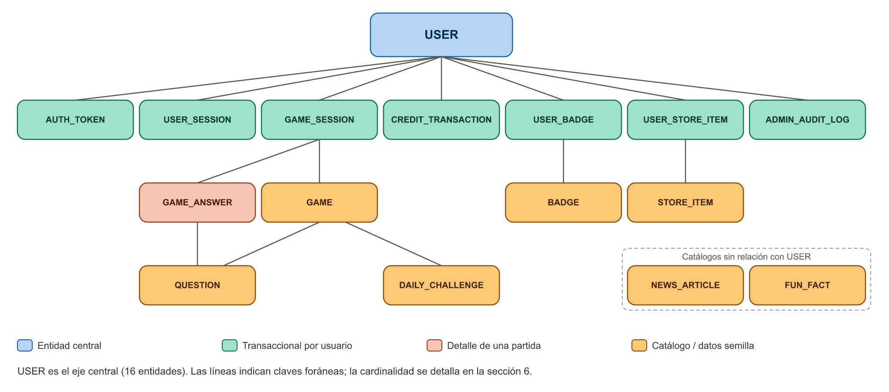

**FOOTBALL MAESTRO**

*Become a Football Maestro*

**DOCUMENTO DE MODELO DE DATOS**

Diseño de la base de datos del sistema

(Complemento del Documento de Arquitectura de Software)

Fecha de elaboración: 23 de septiembre de 2026

Fecha de actualización: 2 de octubre de 2026

Versión: 2.2

---

## 1. Introducción

Este documento describe el modelo de datos del backend de “Football Maestro”, complementando el Documento de Arquitectura de Software. Cada entidad se derivó de las historias de usuario y criterios de aceptación de las 14 pantallas del tablero de Trello (Documento de Requisitos v2): niveles y racha del jugador, preguntas y resultados de minijuegos, reto diario, noticias, saldo y canje de créditos, insignias, actividad de uso para la analítica administrativa, y auditoría del panel administrativo.

## 2. Objetivo del documento

Establecer, de manera formal, las entidades, atributos, claves y relaciones que soportarán la persistencia de datos del sistema, sirviendo como base para la implementación de las capas Entity y Repository descritas en el Documento de Arquitectura de Software.

Motor de base de datos: PostgreSQL, accedido mediante el ORM TypeORM (ver Documento de Arquitectura, sección 8). Los tipos de dato de este documento son lógicos (uuid, string, int, decimal, boolean, date, datetime, enum, json) y se traducen a sus equivalentes de PostgreSQL (uuid, varchar/text, integer, numeric, boolean, date, timestamptz, enum, jsonb) al generar las migraciones.

## 3. Diagrama entidad-relación

El siguiente diagrama muestra las 16 entidades del sistema y sus relaciones principales. USER es la entidad central: casi todas las demás tablas dependen de ella. GAME, QUESTION, DAILY_CHALLENGE, FUN_FACT, NEWS_ARTICLE, BADGE y STORE_ITEM son catálogos (datos semilla o sincronizados, poco cambiantes); el resto son tablas transaccionales que crecen con el uso de la aplicación.

## 4. Decisiones de diseño

| Decisión | Justificación |
| --- | --- |
| credits_balance vive en USER, y además existe CREDIT_TRANSACTION | Patrón de libro contable (ledger): el saldo se consulta rápido desde USER, pero cada movimiento (+50 por reto diario, -500 por compra) queda registrado individualmente en CREDIT_TRANSACTION, permitiendo auditar el origen de cada crédito en vez de solo ver el total final. Ambos se actualizan en la misma transacción de base de datos (Plan de Seguridad, sección 6). |
| QUESTION es una entidad propia, separada de GAME | El backend necesita conocer la respuesta correcta de cada pregunta para calcular el puntaje del lado del servidor (Plan de Seguridad, sección 6). La respuesta correcta nunca se envía al cliente antes de que responda. |
| GAME_ANSWER es una tabla separada de GAME_SESSION | Alimenta directamente la cuadrícula tipo Wordle (verde/rojo por pregunta) que exige ResultsScreen. Cada respuesta se guarda en el momento en que se envía, de modo que una pérdida de conexión no borra el progreso ya registrado (RNF-DISP-03). |
| GAME_SESSION tiene estado (in_progress, completed, abandoned) | Permite distinguir partidas terminadas de las abandonadas (RF-090) y calcular XP y créditos solo una vez, cuando la partida pasa a completed. |
| USER_SESSION registra la actividad de uso | El panel administrativo muestra DAU/MAU, retención D1–D30, duración de sesión y pico de actividad por hora (RF-125, RF-138–RF-143, RF-152). Estas métricas se calculan a partir de USER_SESSION, sin guardar clics ni navegación detallada (minimización de datos, Ley 1581). |
| AUTH_TOKEN guarda refresh tokens y tokens de recuperación | Permite invalidar sesiones de verdad en el servidor al cerrar sesión (RNF-SEC-05) y que el enlace de recuperación de contraseña sea de un solo uso y con vencimiento (RF-035–RF-039). Solo se almacena el hash del token, nunca el token en claro. |
| USER.status (active / inactive) | Soporta la acción Suspender/Activar de AdminUsersScreen (RF-135) y los filtros Activos/Inactivos (RF-131). “Inactivo” equivale a cuenta suspendida: no puede iniciar sesión. |
| NEWS_ARTICLE almacena las noticias sincronizadas | El módulo News consulta periódicamente la API de noticias externa (a través de un Adapter) y guarda los artículos localmente. Así el filtro por categoría y la paginación (RF-071–RF-078) no dependen de la disponibilidad ni de los límites de la API externa en cada petición. |
| ADMIN_AUDIT_LOG existe como entidad propia | Corresponde al requisito no funcional RNF-SEC-04 (“las sesiones de administrador deben quedar registradas, conforme al aviso Access is monitored”). Registra inicios de sesión de administradores y cada acción administrativa. |
| USER_BADGE y USER_STORE_ITEM son tablas intermedias (muchos a muchos) | Un usuario puede tener varias insignias o ítems de la tienda, y una insignia o ítem puede ser obtenido por muchos usuarios; una tabla intermedia evita duplicar datos del catálogo en cada usuario. |
| GAME, QUESTION, DAILY_CHALLENGE, FUN_FACT, BADGE y STORE_ITEM son catálogos separados de sus tablas de uso | Estos datos cambian poco (10 minijuegos, sus preguntas, N insignias, 6 ítems de tienda) y se cargan como datos semilla, independientes de las transacciones de cada usuario. |
| Contenido en inglés y español: columna translations (jsonb) en lugar de tablas de traducción | La app está en inglés (idioma por defecto) y español. Cada registro de contenido guarda su texto original en sus columnas normales y la traducción al otro idioma en translations, ej. {"es": {"name": "Silueta"}}. Los minijuegos y la tienda se escribieron en inglés y las preguntas y los datos curiosos en español; el backend elige el texto según la cabecera Accept-Language. Así no hace falta una tabla y un JOIN por cada tipo de contenido, ni reescribir los datos existentes. Agregar un idioma es agregar su clave en translations. |
| GAME_SESSION.locale y NEWS_ARTICLE.language | La partida guarda el idioma en que empezó: sus preguntas se muestran y se corrigen siempre en ese idioma, aunque el jugador cambie de idioma a mitad de partida (la respuesta correcta también depende del idioma, ej. “No gol” / “No goal”). Las noticias no se traducen: se sincronizan noticias escritas en cada idioma y el feed muestra solo las del idioma del jugador. |
| Partidos y Estadísticas fuera de alcance | El documento de Requisitos, Arquitectura y UML (19 de septiembre) mencionaba calendario y resultados de partidos en vivo. Ninguna de las 14 pantallas del sistema los usa, por lo que no se modela una entidad MATCH en esta versión; queda como trabajo futuro. |

## 5. Diccionario de datos

A continuación se detalla cada entidad con sus campos, tipos de dato y claves (PK = clave primaria, FK = clave foránea). Las entidades se agrupan según el módulo del backend que es su dueño (ver Documento de Arquitectura, sección 3.3).

### 5.1 USER

Cuenta del usuario (jugador o administrador), con sus estadísticas de progreso mostradas en MainHomeScreen, ProfileScreen y AdminUsersScreen. Dueño: módulo Users.

| Campo | Tipo | Clave | Descripción |
| --- | --- | --- | --- |
| `id` | uuid | PK | Identificador único del usuario. |
| `username` | string | único | Nombre de usuario, mostrado como “FootballFan123”. |
| `email` | string | único | Correo electrónico, usado en login. |
| `password_hash` | string | nulo | Contraseña cifrada con bcrypt (hash con salt). Nunca en texto plano. Nulo si la cuenta se creó solo con Google. |
| `google_id` | string | único, nulo | Identificador de Google, si el usuario se registró o vinculó su cuenta con OAuth. |
| `role` | enum |  | “player” o “admin”. |
| `status` | enum |  | “active” o “inactive” (cuenta suspendida por un administrador). Por defecto “active”. |
| `country` | string(2) | nulo | Código de país ISO 3166-1 (ej. “CO”), usado para la bandera en AdminUsersScreen y el top de jugadores. |
| `level` | int |  | Nivel actual (ej. “Lvl 12”), calculado a partir de xp_total. |
| `xp_total` | int |  | Experiencia acumulada total. |
| `streak_days` | int |  | Racha de días consecutivos jugando. |
| `last_played_on` | date | nulo | Último día en que completó una partida; permite calcular y reiniciar la racha. |
| `accuracy` | decimal |  | Precisión histórica en porcentaje (ej. 87%). |
| `credits_balance` | int |  | Saldo actual de créditos (derivado de CREDIT_TRANSACTION). Nunca negativo. |
| `referred_by` | uuid | FK → USER, nulo | Usuario que lo invitó (soporta “Refer a friend +200”). |
| `consent_accepted_at` | datetime |  | Fecha en que aceptó la política de tratamiento de datos (Ley 1581 de 2012). |
| `created_at` | datetime |  | Fecha de registro. |

### 5.2 AUTH_TOKEN

Tokens de larga duración emitidos por el módulo Auth: refresh tokens de sesión y tokens de recuperación de contraseña. Dueño: módulo Auth.

| Campo | Tipo | Clave | Descripción |
| --- | --- | --- | --- |
| `id` | uuid | PK | Identificador único del token. |
| `user_id` | uuid | FK → USER | Usuario dueño del token. |
| `type` | enum |  | “refresh” o “password_reset”. |
| `token_hash` | string | único | Hash (SHA-256) del token. El token en claro nunca se almacena. |
| `expires_at` | datetime |  | Vencimiento (ej. 7 días para refresh, 30 minutos para password_reset). |
| `revoked_at` | datetime | nulo | Fecha en que se revocó (logout) o se usó (password_reset). Un token con valor aquí ya no es válido. |
| `created_at` | datetime |  | Fecha de emisión. |

### 5.3 USER_SESSION

Sesión de uso de la aplicación (desde que el usuario abre la app hasta su última actividad). Es la fuente de las métricas de DAU/MAU, retención, duración de sesión y pico por hora del panel administrativo. Dueño: módulo Users.

| Campo | Tipo | Clave | Descripción |
| --- | --- | --- | --- |
| `id` | uuid | PK | Identificador único de la sesión de uso. |
| `user_id` | uuid | FK → USER | Usuario activo. |
| `started_at` | datetime |  | Inicio de la sesión. |
| `last_seen_at` | datetime |  | Última señal de actividad (heartbeat). La duración de la sesión es last_seen_at − started_at. |

### 5.4 GAME

Catálogo de los 10 minijuegos disponibles en MinigamesScreen. Dueño: módulo Games.

| Campo | Tipo | Clave | Descripción |
| --- | --- | --- | --- |
| `id` | uuid | PK | Identificador único del minijuego. |
| `name` | string |  | Nombre (ej. “Who is it?”, “Silhouette”). |
| `description` | string |  | Descripción corta mostrada en la tarjeta del juego. |
| `category` | enum |  | Players, Clubs, Stadiums, Logic, History, Transfers, Teams o Rules. |
| `difficulty` | enum |  | Easy, Medium, Hard o Expert. |
| `icon` | string |  | Nombre del ícono del minijuego (ej. "shield", "calendar-clock"); el frontend lo dibuja con el color de su estilo. |
| `strategy_key` | string | único | Clave que usa GameFactory para elegir la estrategia de validación y puntaje (ej. “who-is-it”). |
| `sort_order` | int |  | Posición en el catálogo de MinigamesScreen (1 = primero). |
| `translations` | jsonb | nulo | Textos en el otro idioma, por código de idioma (name y description en español; el original está en inglés). Ver decisión de diseño “Contenido en inglés y español”. |

### 5.5 QUESTION

Banco de preguntas de cada minijuego. Dueño: módulo Games.

| Campo | Tipo | Clave | Descripción |
| --- | --- | --- | --- |
| `id` | uuid | PK | Identificador único de la pregunta. |
| `game_id` | uuid | FK → GAME | Minijuego al que pertenece. |
| `statement` | string |  | Enunciado de la pregunta. |
| `options` | json | nulo | Opciones de respuesta, si el minijuego es de selección. |
| `correct_answer` | string |  | Respuesta correcta. Nunca se incluye en las respuestas de la API antes de que el usuario responda. Su formato depende del estilo del minijuego: texto de la opción, número (millones) o JSON (orden de Timeline, grupos de Connections, decisión del VAR). Ver Contrato de API §7.4. |
| `media_url` | string | nulo | Imagen asociada (silueta, escudo, estadio), si aplica. |
| `details` | jsonb | nulo | Datos públicos que usa el estilo del minijuego para dibujar la pregunta (pistas, colores del escudo, trayectoria, alineación…). Se envían al cliente, así que nunca contienen la respuesta. |
| `translations` | jsonb | nulo | Textos en el otro idioma, por código de idioma (statement, options, correct_answer y details en inglés; el banco original está en español). Ver decisión de diseño “Contenido en inglés y español”. |

### 5.6 DAILY_CHALLENGE

Reto diario mostrado en MainHomeScreen (“Football Trivia Blitz”, +50 XP). Dueño: módulo Games.

| Campo | Tipo | Clave | Descripción |
| --- | --- | --- | --- |
| `challenge_date` | date | PK | Día del reto (un reto por día). |
| `game_id` | uuid | FK → GAME | Minijuego que se juega en el reto. |
| `title` | string |  | Título mostrado en la tarjeta. |
| `xp_reward` | int |  | XP adicional por completarlo (50). |
| `credits_reward` | int |  | Créditos por completarlo (50, según CreditsScreen). |

### 5.7 GAME_SESSION

Una partida jugada por un usuario en un minijuego específico. Es la base de ResultsScreen. Dueño: módulo Games.

| Campo | Tipo | Clave | Descripción |
| --- | --- | --- | --- |
| `id` | uuid | PK | Identificador único de la partida. |
| `user_id` | uuid | FK → USER | Usuario que jugó. |
| `game_id` | uuid | FK → GAME | Minijuego jugado. |
| `status` | enum |  | “in_progress”, “completed” o “abandoned”. |
| `locale` | string |  | Idioma de la partida (“en” o “es”, por defecto “en”): sus preguntas se muestran y se corrigen en este idioma. |
| `is_daily_challenge` | boolean |  | Si la partida corresponde al reto diario (otorga la recompensa adicional una sola vez por día). |
| `score` | int | nulo | Puntaje obtenido (ej. 8). Lo calcula el servidor al completar la partida. |
| `total_questions` | int |  | Total de preguntas de la partida (hasta 10). |
| `question_ids` | json |  | Preguntas de la partida en orden (question_ids[0] es la pregunta 1). Se fijan al iniciar, para validar cada respuesta contra la pregunta que realmente se mostró. |
| `accuracy` | decimal | nulo | Porcentaje de precisión de esta partida. |
| `xp_earned` | int | nulo | XP ganado en esta partida. |
| `started_at` | datetime |  | Fecha y hora de inicio. |
| `completed_at` | datetime | nulo | Fecha y hora en que terminó la partida. |
| `shared_at` | datetime | nulo | Primera vez que se compartió el resultado; los +25 créditos por compartir se otorgan una sola vez (RF-099). |

### 5.8 GAME_ANSWER

Cada respuesta individual dentro de una partida. Alimenta la cuadrícula de aciertos/errores de ResultsScreen. Dueño: módulo Games.

| Campo | Tipo | Clave | Descripción |
| --- | --- | --- | --- |
| `id` | uuid | PK | Identificador único de la respuesta. |
| `session_id` | uuid | FK → GAME_SESSION | Partida a la que pertenece. |
| `question_id` | uuid | FK → QUESTION | Pregunta respondida. |
| `question_number` | int | único por sesión | Número de la pregunta dentro de la partida (1 a 10). |
| `given_answer` | string |  | Respuesta enviada por el usuario. |
| `is_correct` | boolean |  | Si la respuesta fue correcta o incorrecta (lo determina el servidor). |
| `answered_at` | datetime |  | Momento en que se registró la respuesta. |

### 5.9 FUN_FACT

Datos curiosos (“Did you know?”) mostrados al final de ResultsScreen. Dueño: módulo Games.

| Campo | Tipo | Clave | Descripción |
| --- | --- | --- | --- |
| `id` | uuid | PK | Identificador único del dato curioso. |
| `text` | string |  | Texto del dato (ej. “El primer Balón de Oro se entregó en 1956.”). |
| `category` | enum | nulo | Categoría relacionada, para mostrar datos afines al minijuego jugado. |
| `translations` | jsonb | nulo | Textos en el otro idioma, por código de idioma (text en inglés; el original está en español). Ver decisión de diseño “Contenido en inglés y español”. |

### 5.10 NEWS_ARTICLE

Noticias sincronizadas desde la API de noticias externa, mostradas en NewsScreen y en la vista previa de MainHomeScreen. Dueño: módulo News.

| Campo | Tipo | Clave | Descripción |
| --- | --- | --- | --- |
| `id` | uuid | PK | Identificador interno del artículo. |
| `external_id` | string | único | Identificador del artículo en la API externa (evita duplicados al sincronizar). |
| `title` | string |  | Título. |
| `title_key` | string |  | Título normalizado (minúsculas, solo letras y números). Una noticia con la misma clave o la misma imagen en el mismo idioma no se guarda de nuevo: evita repetir la nota que publican varios medios (RF-179). |
| `description` | string |  | Resumen mostrado en la tarjeta. |
| `language` | string |  | Idioma de la noticia (“en” o “es”). El feed muestra solo las del idioma del jugador. |
| `category` | enum |  | Transfers, Champions League, World Cup, Premier League, La Liga, Serie A, Bundesliga o Copa Libertadores (“All” es un filtro, no una categoría). |
| `source` | string |  | Fuente (ej. ESPN, Sky Sports, BBC Sport). |
| `source_url` | string |  | Enlace a la noticia original (RF-080). |
| `image_url` | string | nulo | Imagen de la noticia. |
| `published_at` | datetime |  | Fecha de publicación; define el orden del feed (RF-072). |
| `synced_at` | datetime |  | Última vez que la sincronización trajo la noticia. El máximo dice cuándo fue la última sincronización: al arrancar, el backend no vuelve a sincronizar si fue hace menos de NEWS_SYNC_MINUTES. |

### 5.11 CREDIT_TRANSACTION

Registro de cada movimiento de créditos del usuario (ganancia o gasto). Ver decisión de diseño en la sección 4. Dueño: módulo Credits.

| Campo | Tipo | Clave | Descripción |
| --- | --- | --- | --- |
| `id` | uuid | PK | Identificador único de la transacción. |
| `user_id` | uuid | FK → USER | Usuario dueño de la transacción. |
| `amount` | int |  | Cantidad, positiva (ganancia) o negativa (gasto). |
| `type` | enum |  | “earn” o “spend”. |
| `reason` | enum |  | daily_challenge (+50), streak_7_days (+100), share_result (+25), referral (+200) o purchase. Los montos están fijos en el backend. |
| `reference_id` | uuid | nulo | Registro que originó el movimiento (partida, ítem comprado o usuario referido). Índice único (user_id, reason, reference_id): la misma recompensa no se paga dos veces aunque el evento llegue repetido. |
| `created_at` | datetime |  | Fecha del movimiento. |

### 5.12 STORE_ITEM

Catálogo de los 6 ítems de la tienda de CreditsScreen (avatares, marcos, íconos de balón y fondos). Dueño: módulo Credits.

| Campo | Tipo | Clave | Descripción |
| --- | --- | --- | --- |
| `id` | uuid | PK | Identificador único del ítem. |
| `name` | string |  | Nombre (ej. “Golden Ball Avatar”). |
| `item_type` | enum |  | avatar, badge_frame, ball_icon o background (tipos Avatar, Badge Frame, Ball Icon y Stadium de CreditsScreen). |
| `cost` | int |  | Costo en créditos. |
| `icon` | string |  | Emoji o ícono representativo. |
| `translations` | jsonb | nulo | Textos en el otro idioma, por código de idioma (name en español; el original está en inglés). Ver decisión de diseño “Contenido en inglés y español”. |

### 5.13 USER_STORE_ITEM

Tabla intermedia: qué ítems de la tienda ha comprado cada usuario (relación muchos a muchos entre USER y STORE_ITEM). Dueño: módulo Credits.

| Campo | Tipo | Clave | Descripción |
| --- | --- | --- | --- |
| `user_id` | uuid | FK → USER (PK compuesta) | Usuario que compró el ítem. |
| `item_id` | uuid | FK → STORE_ITEM (PK compuesta) | Ítem comprado. La PK compuesta impide comprar el mismo ítem dos veces. |
| `is_equipped` | boolean |  | Si el ítem está aplicado actualmente al perfil (RF-119). Solo uno por item_type. |
| `purchased_at` | datetime |  | Fecha de la compra. |

### 5.14 BADGE

Catálogo de insignias que un usuario puede ganar, mostradas en ProfileScreen y MainHomeScreen. Dueño: módulo Users.

| Campo | Tipo | Clave | Descripción |
| --- | --- | --- | --- |
| `id` | uuid | PK | Identificador único de la insignia. |
| `code` | string | único | Código fijo con el que el backend otorga la insignia (ej. “streak-7”); el nombre visible puede cambiar sin romper las reglas. |
| `name` | string |  | Nombre de la insignia. |
| `icon` | string |  | Ícono representativo. |
| `description` | string |  | Descripción de cómo se obtiene. |
| `translations` | jsonb | nulo | Textos en el otro idioma, por código de idioma (name y description en inglés; el original está en español). Ver decisión de diseño “Contenido en inglés y español”. |

### 5.15 USER_BADGE

Tabla intermedia: qué insignias ha ganado cada usuario (relación muchos a muchos entre USER y BADGE). Dueño: módulo Users.

| Campo | Tipo | Clave | Descripción |
| --- | --- | --- | --- |
| `user_id` | uuid | FK → USER (PK compuesta) | Usuario que ganó la insignia. |
| `badge_id` | uuid | FK → BADGE (PK compuesta) | Insignia ganada. |
| `earned_at` | datetime |  | Fecha en que se ganó. |

### 5.16 ADMIN_AUDIT_LOG

Registro de auditoría de acciones administrativas, según RNF-SEC-04 del Documento de Requisitos. Dueño: módulo Admin.

| Campo | Tipo | Clave | Descripción |
| --- | --- | --- | --- |
| `id` | uuid | PK | Identificador único del registro. |
| `admin_user_id` | uuid | FK → USER | Administrador que realizó la acción. |
| `action` | string |  | Acción realizada (ej. “Admin login”, “Suspend user”, “Delete user”, “Export report”). |
| `target_user_id` | uuid | nulo | Usuario afectado por la acción, si aplica. No es FK para conservar el registro aunque el usuario se elimine. |
| `details` | string | nulo | Detalle adicional de la acción. |
| `ip_address` | string |  | Dirección IP desde la que se realizó. |
| `created_at` | datetime |  | Fecha y hora de la acción. |

## 6. Resumen de relaciones

| Entidad origen | Relación | Entidad destino | Cardinalidad |
| --- | --- | --- | --- |
| USER | tiene | AUTH_TOKEN | 1:N |
| USER | abre | USER_SESSION | 1:N |
| USER | juega | GAME_SESSION | 1:N |
| GAME | genera | GAME_SESSION | 1:N |
| GAME | contiene | QUESTION | 1:N |
| GAME | se usa en | DAILY_CHALLENGE | 1:N |
| GAME_SESSION | contiene | GAME_ANSWER | 1:N |
| QUESTION | es respondida en | GAME_ANSWER | 1:N |
| USER | tiene | CREDIT_TRANSACTION | 1:N |
| USER | gana | BADGE | N:M (vía USER_BADGE) |
| USER | compra | STORE_ITEM | N:M (vía USER_STORE_ITEM) |
| USER | refiere a | USER | 1:N (referred_by) |
| USER (admin) | realiza | ADMIN_AUDIT_LOG | 1:N |
| NEWS_ARTICLE, FUN_FACT | — | — | Catálogos sin claves foráneas |

## 7. Consideraciones finales

Este modelo de datos debe revisarse junto con el Documento de Arquitectura de Software: cada entidad aquí definida corresponde a un Repository dentro del módulo indicado como su dueño (USER, USER_SESSION, BADGE y USER_BADGE en Users; AUTH_TOKEN en Auth; GAME, QUESTION, DAILY_CHALLENGE, GAME_SESSION, GAME_ANSWER y FUN_FACT en Games; NEWS_ARTICLE en News; CREDIT_TRANSACTION, STORE_ITEM y USER_STORE_ITEM en Credits; ADMIN_AUDIT_LOG en Admin). Ningún módulo accede directamente a las tablas de otro: el módulo Admin obtiene sus métricas a través de las interfaces públicas de Users, Games y Credits.

Índices recomendados: GAME_SESSION(user_id, completed_at), GAME_SESSION(game_id, completed_at), USER_SESSION(started_at), CREDIT_TRANSACTION(user_id, created_at), NEWS_ARTICLE(category, published_at), NEWS_ARTICLE(language, category, published_at), NEWS_ARTICLE(language, title_key) y USER(status, created_at), que soportan los filtros y agregaciones del panel administrativo (RNF-PERF-03, RNF-MANT-04).

## 8. Historial de versiones

| Versión | Fecha | Cambios |
| --- | --- | --- |
| 1.0 | 23 de septiembre de 2026 | Versión inicial (10 entidades). |
| 1.1 | 23 de septiembre de 2026 | Revisión de consistencia con los demás documentos: se corrige el conteo de entidades; se agregan AUTH_TOKEN, USER_SESSION, QUESTION, DAILY_CHALLENGE, FUN_FACT y NEWS_ARTICLE; USER suma status, country, last_played_on, referred_by y consent_accepted_at; GAME_SESSION suma status, is_daily_challenge, xp_earned y started_at; GAME_ANSWER suma question_id, given_answer y answered_at; se fija PostgreSQL + TypeORM; Partidos y Estadísticas queda fuera de alcance. |
| 1.2 | 24 de septiembre de 2026 | STORE_ITEM.item_type suma ball_icon, que usa el artículo “Fire Ball Icon” de CreditsScreen (detectado al implementar feature/backend-base). |
| 1.3 | 24 de septiembre de 2026 | Detectado al implementar feature/games: GAME suma sort_order (orden del catálogo) y GAME_SESSION suma question_ids (preguntas fijadas al iniciar la partida) y shared_at (créditos por compartir una sola vez). |
| 1.4 | 24 de septiembre de 2026 | Detectado al implementar feature/users: BADGE suma code, para otorgar insignias por código y no por nombre. |
| 1.5 | 24 de septiembre de 2026 | Detectado al implementar feature/credits: índice único en CREDIT_TRANSACTION (user_id, reason, reference_id) para que cada recompensa se pague una sola vez. |
| 1.6 | 24 de septiembre de 2026 | Actualización general de la documentación: verificado contra la base de datos real (las 16 tablas y sus 110 columnas coinciden con este diccionario). Sin cambios de esquema desde la versión 1.5. |
| 1.7 | 24 de septiembre de 2026 | QUESTION.details (jsonb) para el estilo propio de cada minijuego (migraciones TimelineOrderingQuestions y GameStyleDetails); correct_answer admite formatos por estilo. Banco inicial de 203 preguntas. |
| 1.8 | 24 de septiembre de 2026 | GAME.icon guarda el nombre del ícono del minijuego en lugar de un emoji. |
| 1.9 | 25 de septiembre de 2026 | Inglés y español: columna translations (jsonb) en GAME, QUESTION, FUN_FACT y STORE_ITEM; GAME_SESSION.locale; NEWS_ARTICLE.language con su índice (migraciones ContentTranslations y NewsLanguage). Las 203 preguntas tienen su traducción al inglés. |
| 2.0 | 25 de septiembre de 2026 | BADGE suma translations (migración BadgeTranslations): las insignias también están en inglés y español. |
| 2.1 | 27 de septiembre de 2026 | NEWS_ARTICLE suma title_key con su índice y 4 categorías (migración NewsFiltersDedup, que además borra las noticias repetidas y las de otros deportes ya guardadas). |
| 2.2 | 2 de octubre de 2026 | NEWS_ARTICLE.synced_at (migración NewsSyncedAt): evita gastar el cupo de noticias cada vez que el servidor de Render despierta. |
