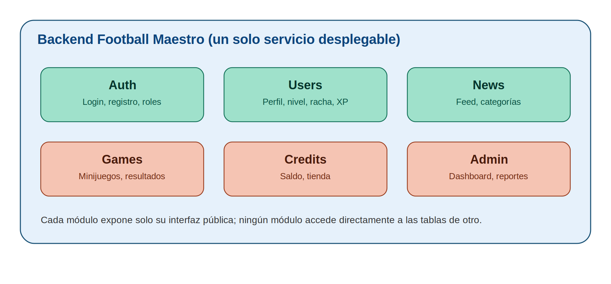
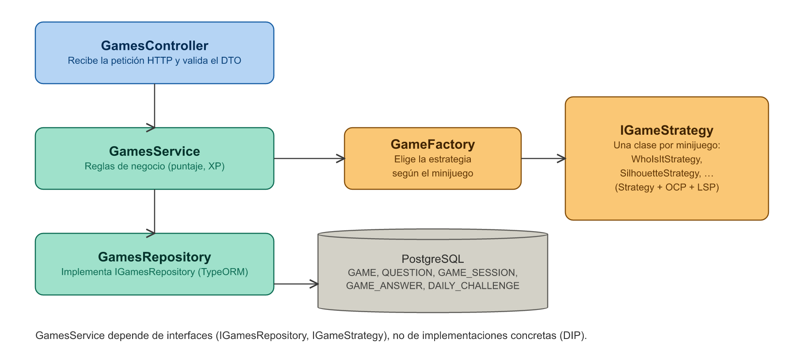
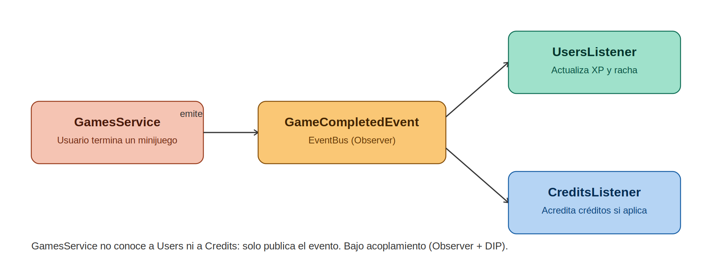
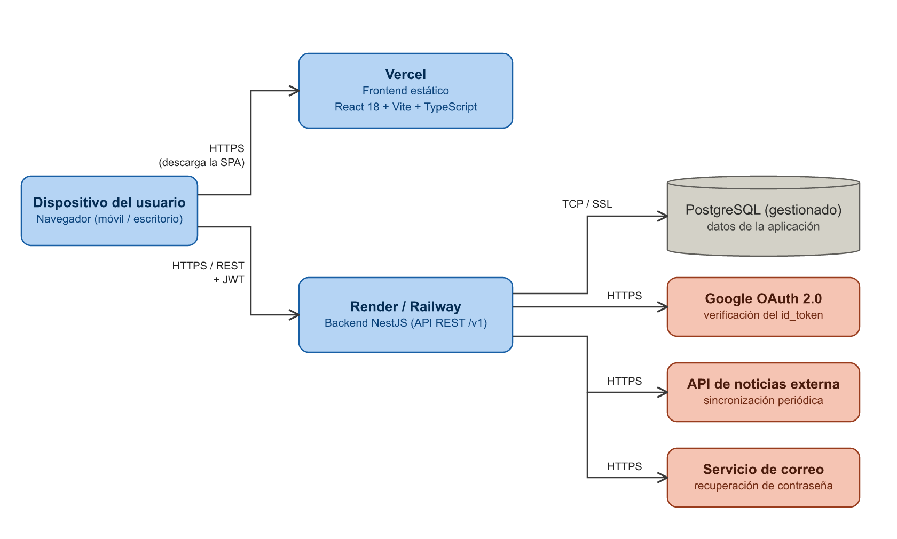

**FOOTBALL MAESTRO**

*Become a Football Maestro*

**DOCUMENTO DE ARQUITECTURA DE SOFTWARE**

Diseño de la arquitectura lógica y física del sistema

(Backlog del Proyecto — Tablero Trello “Football Maestro”)

Fecha de elaboración: 23 de septiembre de 2026

Fecha de actualización: 24 de septiembre de 2026

Versión: 1.3

---

## 1. Introducción

Este documento define la arquitectura de software propuesta para el backend de “Football Maestro”, complementando el Documento de Requisitos Funcionales y No Funcionales (v2) y el tablero de historias de usuario del proyecto en Trello. El frontend (React 18 + TypeScript + Vite + Tailwind CSS) ya existe como maqueta funcional; este documento se centra en el backend que dará soporte real a sus 14 pantallas:

- Acceso (4): SplashScreen, WelcomeScreen, SignInScreen, RegisterScreen.
- Jugador (6, con navegación inferior BottomNav de 5 pestañas: Home, Games, News, Credits, Profile): MainHomeScreen, MinigamesScreen, ResultsScreen, NewsScreen, CreditsScreen, ProfileScreen.
- Administrador (4, con navegación inferior AdminBottomNav): AdminDashboardScreen, AdminUsersScreen, AdminAnalyticsScreen, AdminReportsScreen.

El objetivo es establecer un estilo arquitectónico, una organización modular del código, los patrones de diseño aplicables a cada módulo, cómo se materializan los principios SOLID en la implementación y cómo se despliega físicamente el sistema.

Alcance: el módulo “Partidos y Estadísticas” (calendario y resultados en vivo) mencionado en el documento de Requisitos, Arquitectura y UML del 19 de septiembre no tiene ninguna pantalla en el sistema actual y queda fuera de alcance como trabajo futuro (ver sección 10).

## 2. Objetivo del documento

Establecer, de manera formal y trazable, el diseño arquitectónico del sistema (estilo arquitectónico, módulos, capas, patrones de diseño, principios SOLID y vista de despliegue) que servirá como base para la implementación del backend, garantizando bajo acoplamiento, alta cohesión y facilidad de mantenimiento y extensión.

## 3. Estilo arquitectónico

Se adopta un monolito modular por dominios: el backend se despliega como una única aplicación, pero el código está organizado en módulos independientes por dominio de negocio, cada uno con su propia lógica interna y comunicándose con los demás solo a través de interfaces públicas bien definidas (nunca accediendo directamente a las tablas de otro módulo).

### 3.1 Comparación de alternativas evaluadas

| Alternativa | Ventajas | Por qué no se eligió / se eligió |
| --- | --- | --- |
| Monolito simple (sin módulos) | Muy rápido de iniciar | En cuanto el proyecto crece (14 pantallas, panel admin de 4 pantallas) se acopla todo y viola SOLID fácilmente. |
| Microservicios desde el inicio | Escalabilidad y despliegue independiente por dominio | Añade complejidad de infraestructura (orquestación, red, consistencia entre servicios) injustificada para el tamaño actual del proyecto y del equipo. |
| Monolito modular por dominios (elegido) | Un solo despliegue simple, código desacoplado por dominio, fácil de extraer un módulo a microservicio en el futuro si se necesita | Es el punto de equilibrio adecuado para el tamaño y la etapa actual del proyecto. |

### 3.2 Diagrama general de módulos



### 3.3 Módulos del sistema

| Módulo | Responsabilidad | Pantallas relacionadas (Trello) |
| --- | --- | --- |
| Auth | Login y registro con correo/contraseña, autenticación con Google (OAuth 2.0), refresh tokens, cierre de sesión, recuperación de contraseña y gestión de roles Player/Admin. | WelcomeScreen, SignInScreen, RegisterScreen (SplashScreen verifica la sesión) |
| Users | Perfil, nivel, racha, XP, precisión, insignias, configuración de cuenta y registro de la actividad de uso (USER_SESSION) que alimenta la analítica. | ProfileScreen, MainHomeScreen (header y “My Stats”) |
| News | Sincronización periódica de la API de noticias externa, feed y filtrado por categoría. | NewsScreen, MainHomeScreen (vista previa) |
| Games | Catálogo de minijuegos, preguntas, reto diario, lógica de cada juego, cálculo de resultados y datos curiosos. | MinigamesScreen, ResultsScreen, MainHomeScreen (reto diario y vista previa) |
| Credits | Saldo de créditos, formas de ganarlos, tienda de canje e ítems aplicados al perfil. | CreditsScreen |
| Admin | Dashboard, gestión de usuarios, analítica, reportes y registro de auditoría. Consulta a Users, Games y Credits solo a través de sus interfaces públicas. | AdminDashboardScreen, AdminUsersScreen, AdminAnalyticsScreen, AdminReportsScreen |

## 4. Arquitectura en capas por módulo

Cada uno de los 6 módulos sigue internamente la misma estructura en capas, ilustrada a continuación con el módulo Games como ejemplo (la misma estructura aplica a Auth, Users, News, Credits y Admin):



| Capa | Responsabilidad |
| --- | --- |
| Controller | Recibe la petición HTTP, valida el DTO de entrada y delega al Service. No contiene lógica de negocio. |
| Service | Contiene las reglas de negocio del dominio. Orquesta repositorios, estrategias y eventos. |
| Repository | Encapsula el acceso a datos detrás de una interfaz (p. ej. IGamesRepository), independiente del motor de base de datos. |
| Entity / DB | Modelo de persistencia (entidades TypeORM) y almacenamiento real de los datos en PostgreSQL. Ver Documento de Modelo de Datos. |

## 5. Comunicación entre módulos: eventos de dominio

Para evitar que los módulos se llamen directamente entre sí (acoplamiento fuerte), la comunicación entre dominios se realiza mediante eventos. Ejemplo: al completar un minijuego, Games no conoce ni llama a Users ni a Credits directamente — publica un evento que cada módulo interesado escucha por su cuenta.



Eventos de dominio definidos:

| Evento | Emisor | Qué hacen los módulos que lo escuchan |
| --- | --- | --- |
| GameCompletedEvent | Games | Users: suma XP, recalcula nivel, precisión y racha, y otorga insignias. Credits: +50 si la partida era el reto diario (una vez por día). |
| StreakReachedEvent | Users | Credits: +100 al alcanzar una racha de 7 días. |
| ResultSharedEvent | Games | Credits: +25 por compartir un resultado (una vez por partida). |
| UserRegisteredEvent | Auth | Users: crea el perfil inicial. Credits: +200 al usuario que lo refirió, si existe. |
| AdminActionEvent | Admin, Auth | Admin: guarda el registro en ADMIN_AUDIT_LOG (login de administrador, suspender, activar, eliminar, exportar). |

## 6. Patrones de diseño aplicados

Cada patrón se seleccionó para resolver un problema concreto identificado en las historias de usuario del tablero, no de forma genérica.

| Patrón | Módulo(s) | Problema que resuelve |
| --- | --- | --- |
| Repository | Todos | Separa la lógica de negocio de cómo se persisten los datos; el Service nunca depende de un motor de base de datos concreto. |
| Strategy | Games | Los 10 minijuegos (Who is it?, Silhouette, Guess the Badge, etc.) tienen reglas de validación y puntaje distintas. Cada uno implementa IGameStrategy en vez de un condicional gigante. |
| Factory Method | Games | GameFactory decide qué estrategia instanciar según el strategy_key del minijuego elegido, sin acoplar ese conocimiento al resto del módulo. |
| Observer (eventos de dominio) | Games, Users, Auth → Users, Credits, Admin | Al completar un minijuego, compartir un resultado o registrarse, varios módulos reaccionan (XP, racha, créditos, auditoría) sin que el emisor los conozca directamente. |
| Adapter | Auth (Google OAuth, correo), News (API externa) | Aísla librerías/API externas detrás de una interfaz propia; cambiar de proveedor solo afecta al adapter. |
| DTO (Data Transfer Object) | Todos | El contrato HTTP nunca expone directamente el modelo de base de datos (p. ej. password_hash o correct_answer). |
| Facade | Admin → Dashboard / Analytics / Reports | AdminDashboardService, AdminAnalyticsService y AdminReportsService reúnen datos de Users y Games a través de sus interfaces públicas de estadísticas (UsersStatsService y GamesStatsService), sin consultar sus tablas directamente. |

## 7. Principios SOLID aplicados

| Principio | Aplicación concreta en Football Maestro |
| --- | --- |
| S — Single Responsibility | AuthService solo autentica; la actualización del perfil de usuario es responsabilidad exclusiva de UsersService. |
| O — Open/Closed | Gracias a IGameStrategy, agregar un minijuego 11 no modifica ninguna clase existente: solo se crea una nueva clase que implementa la interfaz y se registra en el factory (RNF-MANT-01). |
| L — Liskov Substitution | Cualquier clase que implemente IGameStrategy debe poder sustituir a otra sin romper GamesService (mismo contrato de entrada/salida para validar y puntuar). |
| I — Interface Segregation | En Admin se separan IUserManagement (suspender, activar, eliminar) de IReportExport (generar CSV) en vez de una única interfaz gigante que obligue a depender de métodos que no se usan. |
| D — Dependency Inversion | GamesService depende de la interfaz IGamesRepository, no de una implementación concreta de ORM — permite cambiar de motor de base de datos o usar un repositorio falso (mock) en pruebas sin tocar la lógica de negocio. |

## 8. Stack tecnológico y estructura de carpetas

### 8.1 Stack tecnológico

| Capa | Tecnología | Justificación |
| --- | --- | --- |
| Frontend | React 18 + TypeScript, Vite, Tailwind CSS, Recharts, Motion | Es el stack del prototipo ya construido (14 pantallas). Se despliega como sitio estático. |
| Backend | Node.js + NestJS + TypeScript | Comparte lenguaje con el frontend y su arquitectura está construida nativamente alrededor de Inyección de Dependencias, módulos y decoradores, lo que facilita demostrar SOLID y los patrones anteriores de forma explícita. |
| Base de datos | PostgreSQL + TypeORM | Modelo relacional para usuarios, partidas, créditos y actividad; consultas parametrizadas vía ORM (Plan de Seguridad, A03). |
| Autenticación | JWT de acceso + refresh token (cookie httpOnly), bcrypt, Google OAuth 2.0 | Roles diferenciados Player/Admin validados en el backend (RNF-SEC-03) e invalidación real de sesión (RNF-SEC-05). |
| Servicios externos | Currents API (noticias; plan gratuito de 250 peticiones/día, sin retraso), Google OAuth 2.0, servicio de correo transaccional (por definir) | Consumidos siempre a través de Adapters (sección 6). |
| Hosting | Vercel (frontend), Render o Railway (backend y PostgreSQL gestionado) | Planes gratuitos suficientes para el prototipo académico. |

Redis y WebSockets (Socket.IO), propuestos en el documento del 19 de septiembre para resultados de partidos en vivo, no son necesarios en el alcance actual: ninguna de las 14 pantallas muestra datos en tiempo real. Se reconsiderarán si se implementa el módulo futuro de Partidos y Estadísticas.

### 8.2 Estructura de carpetas propuesta (NestJS)

```
football-maestro-backend/
├── src/
│   ├── auth/           (Controller, Service, Module, Strategies JWT/Google,
│   │                    Guards, Repository de AUTH_TOKEN, Adapter de correo, DTO)
│   ├── users/          (Controller, Service, Module, Repository, Entity, DTO,
│   │                    Listeners, activity/ para USER_SESSION)
│   ├── news/           (Controller, Service, Module, Repository,
│   │                    Adapter API externa, tarea de sincronización)
│   ├── games/          (Controller, Service, Module, Repository,
│   │                    Strategies/*.strategy.ts, Factory, Events)
│   ├── credits/        (Controller, Service, Module, Repository, Listeners)
│   ├── admin/
│   │   ├── dashboard/
│   │   ├── users-management/
│   │   ├── analytics/  (Service tipo Facade)
│   │   ├── reports/    (Service tipo Facade)
│   │   └── audit/      (Repository de ADMIN_AUDIT_LOG, Listener)
│   ├── shared/         (decorators, filters, interceptors, event-bus)
│   └── app.module.ts
├── test/
└── package.json
```

## 9. Vista física (despliegue)

El siguiente diagrama muestra cómo se distribuyen físicamente los componentes. El navegador descarga el frontend estático desde Vercel y consume la API REST del backend directamente; solo el backend se comunica con la base de datos y con los servicios externos.



| Nodo | Contenido | Comunicación |
| --- | --- | --- |
| Dispositivo del usuario | Navegador web (móvil o escritorio) | HTTPS hacia Vercel (descarga de la SPA) y hacia la API (/v1, con JWT). |
| Vercel | Frontend React + Vite compilado (archivos estáticos) | Solo sirve archivos; no accede a datos. |
| Render / Railway | Backend NestJS (monolito modular) | TCP/SSL hacia PostgreSQL; HTTPS hacia Google, la API de noticias y el servicio de correo. |
| PostgreSQL gestionado | Las 16 entidades del Modelo de Datos | Solo accesible desde el backend (credenciales en variables de entorno). |
| Servicios externos | Google OAuth 2.0, API de noticias, servicio de correo transaccional | Consumidos mediante Adapters; un fallo de Google no bloquea el login con correo (RNF-DISP-02). |

## 10. Consideraciones finales

Esta arquitectura debe evolucionar junto con el tablero de historias de usuario en Trello. Cualquier módulo que crezca significativamente en autonomía y volumen de datos (por ejemplo Games o Admin) es candidato, en una etapa posterior, a extraerse como microservicio independiente, dado que ya está diseñado con bajo acoplamiento hacia el resto del sistema.

Trabajo futuro: el módulo “Partidos y Estadísticas” (calendario, resultados en vivo y estadísticas de equipos a partir de API-Football o football-data.org) se agregaría como un séptimo módulo con su propio Adapter y, si se requiere tiempo real, Redis y WebSockets. Antes de implementarlo debe existir su pantalla y sus historias de usuario en el tablero.

## 11. Historial de versiones

| Versión | Fecha | Cambios |
| --- | --- | --- |
| 1.0 | 23 de septiembre de 2026 | Versión inicial. |
| 1.1 | 23 de septiembre de 2026 | Revisión de consistencia: se listan las 14 pantallas; se amplían las responsabilidades de cada módulo (refresh tokens, recuperación de contraseña, actividad de uso, reto diario, sincronización de noticias, auditoría); se corrige el diagrama de capas (tablas reales en lugar de “games / results”); se agregan la tabla de eventos de dominio, el stack tecnológico (frontend React + Vite, PostgreSQL + TypeORM) y la vista física de despliegue; Partidos y Estadísticas queda como trabajo futuro. |
| 1.2 | 24 de septiembre de 2026 | Al implementar feature/news se eligió Currents API como fuente de noticias (plan gratuito para prototipos). Sin clave, el módulo usa noticias de ejemplo; cambiar de proveedor es implementar otro NewsProvider. |
| 1.3 | 24 de septiembre de 2026 | Al implementar feature/admin: Users y Games exponen servicios públicos de estadísticas (UsersStatsService, GamesStatsService) que usa el Facade del panel administrativo; nuevo evento UserSuspendedEvent (Admin → Auth). |
