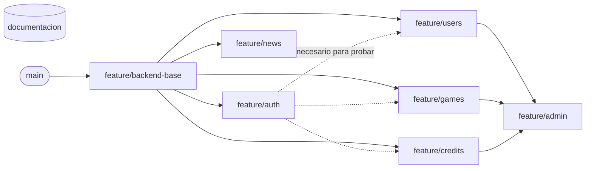

# Estructura del proyecto Football Maestro

Esta guía describe cómo se organiza el repositorio, cómo se estructura el backend y cómo trabajamos con ramas. El detalle técnico está en los documentos de diseño (ver [Documentos de referencia](#7-documentos-de-referencia)).

## 1. Visión general

| Parte | Tecnología | Estado |
|---|---|---|
| Frontend | React 18 + TypeScript + Vite + Tailwind CSS | Maqueta funcional con las 14 pantallas (datos simulados) |
| Backend | Node.js + NestJS + TypeScript | Base lista en `feature/backend-base`; un módulo por rama |
| Base de datos | PostgreSQL + TypeORM | 16 tablas definidas en el Modelo de Datos |
| Servicios externos | Google OAuth 2.0, API de noticias, servicio de correo | Se consumen mediante Adapters |

Pantallas que el backend debe soportar:

- **Acceso (4):** SplashScreen, WelcomeScreen, SignInScreen, RegisterScreen.
- **Jugador (6):** MainHomeScreen, MinigamesScreen, ResultsScreen, NewsScreen, CreditsScreen, ProfileScreen.
- **Administrador (4):** AdminDashboardScreen, AdminUsersScreen, AdminAnalyticsScreen, AdminReportsScreen.

Fuera de alcance por ahora: el módulo de **Partidos y Estadísticas** (no tiene pantalla).

## 2. Estructura del repositorio

El repositorio separa el código y la documentación en ramas distintas:

- **`main` y las ramas `feature/*`** contienen el código (frontend y backend).
- **`documentacion`** es una rama independiente, sin historia compartida con `main`, que contiene **solo** documentación. No se une a `main`; se actualiza directamente.

Código (`main` y `feature/*`):

```
Football-Maestro/
├── .gitignore                      (se agrega en feature/backend-base)
├── project/                        Frontend (React + Vite, generado con Figma Make)
│   ├── package.json
│   ├── vite.config.ts
│   └── src/
│       ├── app/
│       │   ├── App.tsx             Navegación entre pantallas
│       │   └── components/         Las 14 pantallas + BottomNav / AdminBottomNav
│       └── styles/
└── backend/                        Backend NestJS (se crea en feature/backend-base)
    └── ...                         ver sección 3
```

Documentación (rama `documentacion`):

```
Football-Maestro/
├── README.md                       ← este documento
├── Documento_Requisitos_Funcionales_NoFuncionales_FootballMaestro_v2.md
├── Football_Maestro_Requisitos_Arquitectura_UML.docx
├── Documento_Arquitectura_Software_FootballMaestro.docx / .md
├── Documento_Modelo_Datos_FootballMaestro.docx / .md
├── Documento_Contrato_API_FootballMaestro.docx / .md
├── Plan_Pruebas_FootballMaestro.docx / .md
├── Plan_Seguridad_FootballMaestro.docx / .md
└── *_images/                       Diagramas usados por los .md
```

## 3. Estructura del backend

Monolito modular: una sola aplicación, dividida en 6 módulos independientes. Un módulo nunca lee las tablas de otro; se comunican por interfaces públicas o por eventos de dominio.

```
backend/
├── package.json
├── docker-compose.yml              PostgreSQL 16 para desarrollo
├── .env.example                    Variables necesarias (sin valores reales)
├── src/
│   ├── main.ts
│   ├── app.module.ts
│   ├── config/                     Lectura y validación de variables de entorno
│   ├── database/
│   │   ├── migrations/             Creación de las 16 tablas
│   │   └── seeds/                  10 minijuegos, preguntas, 6 ítems de tienda, insignias
│   ├── shared/                     Decoradores, filtros de error, guards, event bus
│   │
│   ├── auth/                       Registro, login, Google, refresh token, logout, recuperar contraseña
│   ├── users/                      Perfil, estadísticas, insignias, actividad de uso
│   ├── news/                       Sincronización con la API de noticias, feed y filtros
│   ├── games/                      Minijuegos, preguntas, reto diario, partidas, puntaje
│   │   └── strategies/             Una estrategia por minijuego (patrón Strategy)
│   ├── credits/                    Saldo, formas de ganar créditos, tienda
│   └── admin/
│       ├── dashboard/
│       ├── users-management/
│       ├── analytics/
│       ├── reports/
│       └── audit/                  Registro de auditoría (ADMIN_AUDIT_LOG)
└── test/                           Pruebas E2E (Supertest)
```

Cada módulo tiene las mismas capas:

| Capa | Archivo típico | Responsabilidad |
|---|---|---|
| Controller | `games.controller.ts` | Recibe la petición HTTP y valida el DTO |
| Service | `games.service.ts` | Reglas de negocio |
| Repository | `games.repository.ts` | Acceso a datos detrás de una interfaz |
| Entity | `game.entity.ts` | Tabla de la base de datos (TypeORM) |
| DTO | `dto/*.dto.ts` | Forma exacta de lo que entra y sale por la API |

Las pruebas unitarias van junto al archivo que prueban (`games.service.spec.ts`).

## 4. Ramas

### 4.1 Ramas del proyecto

| Rama | Contenido | Sale de | Documentos que implementa |
|---|---|---|---|
| `main` | Versión estable. Solo recibe cambios por Pull Request | — | — |
| `documentacion` | Solo documentación: documentos de diseño y esta guía. No se une a `main` | — (rama independiente) | Todos |
| `feature/backend-base` | Proyecto NestJS, conexión a PostgreSQL, migraciones, seeds, `.gitignore`, configuración común | `main` | Modelo de Datos, Arquitectura §8 |
| `feature/auth` | Registro, login Player/Admin, Google, refresh token, logout, recuperar contraseña | `feature/backend-base` | API §4, Seguridad §5 |
| `feature/users` | Perfil, estadísticas, insignias, cambiar contraseña, borrar cuenta, actividad de uso | `feature/backend-base` | API §5 |
| `feature/games` | Catálogo, preguntas, reto diario, partidas, respuestas, puntaje, compartir | `feature/backend-base` | API §7, Seguridad §6 |
| `feature/credits` | Saldo, formas de ganar créditos, historial, tienda y compras | `feature/backend-base` | API §8 |
| `feature/news` | Adapter de la API de noticias, sincronización, feed y filtros | `feature/backend-base` | API §6 |
| `feature/admin` | Dashboard, gestión de usuarios, analytics, reportes CSV, auditoría | `feature/backend-base` | API §9 |
| `feature/frontend-api` | Frontend (`project/`) conectado a la API; incluye todo el backend | `feature/admin` | API (todas las pantallas) |
| `refactor/arquitectura` | Repositorios con interfaz, Unit of Work, interfaces públicas entre módulos, prueba de arquitectura | `feature/frontend-api` | Arquitectura §3-§7 |

### 4.2 Orden de trabajo



1. **`feature/backend-base`** va primero; nadie puede empezar un módulo sin ella.
2. **`feature/auth`** es la segunda prioridad: todos los endpoints (salvo los públicos) necesitan un usuario autenticado.
3. **`users`, `games`, `credits` y `news`** pueden hacerse en paralelo, cada uno por una persona distinta.
4. **`feature/admin`** va al final, porque sus métricas usan datos de Users, Games y Credits.

Cuando una rama se une a `main`, las demás ramas abiertas deben traer esos cambios (`git merge main`) para no quedar desactualizadas.

## 5. Flujo de trabajo

```bash
# 1. Partir siempre de la versión más reciente
git checkout main
git pull

# 2. Crear la rama (o cambiarse a una existente)
git checkout -b feature/games feature/backend-base

# 3. Trabajar con commits pequeños
git add .
git commit -m "feat(games): calcular puntaje en el servidor"

# 4. Subir la rama
git push -u origin feature/games

# 5. Abrir un Pull Request hacia main en GitHub y pedir revisión
```

### Convenciones

**Nombres de rama:** `feature/<modulo>` para funcionalidad nueva y `fix/<descripcion>` para correcciones. Los cambios de documentación se hacen en la rama `documentacion` (`git checkout documentacion`), no en ramas de código.

**Mensajes de commit:** formato `tipo(módulo): descripción en minúscula`.

| Tipo | Uso |
|---|---|
| `feat` | Funcionalidad nueva |
| `fix` | Corrección de un error |
| `test` | Agregar o corregir pruebas |
| `docs` | Documentación |
| `refactor` | Reorganizar código sin cambiar su comportamiento |
| `chore` | Configuración, dependencias |

**Nunca subir al repositorio:** el archivo `.env`, contraseñas, claves de Google o de la base de datos, ni la carpeta `node_modules/`.

### Checklist de cada Pull Request

Tomado de la *Definition of Done* del Plan de Pruebas:

- [ ] Los RF del módulo están implementados según el Contrato de API.
- [ ] Los casos de prueba del Plan de Pruebas que corresponden al módulo pasan.
- [ ] La suite completa de pruebas sigue en verde (sin regresiones).
- [ ] No se exponen campos sensibles (`password_hash`, `correct_answer`, tokens).
- [ ] Al menos una persona del equipo revisó el Pull Request.

## 6. Entorno local

Requisitos:

- Node.js 20 o superior (incluye npm, que es el gestor de paquetes del backend)
- Docker Desktop, para correr PostgreSQL 16 sin instalarlo (`backend/docker-compose.yml`)

Los pasos para levantar el backend por primera vez están en `backend/README.md`.

Variables de entorno del backend (documentadas en `backend/.env.example`):

| Variable | Para qué sirve |
|---|---|
| `PORT` | Puerto de la API (por defecto `3000`) |
| `DB_HOST`, `DB_PORT`, `DB_NAME`, `DB_USER`, `DB_PASSWORD` | Conexión a PostgreSQL (los mismos valores usa `docker-compose.yml`) |
| `JWT_SECRET` | Firma de los access tokens |
| `JWT_EXPIRES_IN` | Duración del access token (ej. `15m`) |
| `REFRESH_TOKEN_DAYS` | Duración del refresh token (ej. `7`) |
| `GOOGLE_CLIENT_ID` | Verificación del login con Google |
| `NEWS_API_KEY` | API de noticias externa |
| `MAIL_API_KEY` | Envío de correos de recuperación |
| `FRONTEND_URL` | Origen permitido por CORS |

## 7. Documentos de referencia

| Documento | Para qué consultarlo |
|---|---|
| Requisitos Funcionales y No Funcionales v2.1 | Qué debe hacer cada pantalla (RF-001 a RF-153) |
| Requisitos, Arquitectura y UML | Resumen académico, casos de uso, clases y despliegue |
| Arquitectura de Software 1.4 | Módulos, interfaces públicas, capas, patrones, SOLID, eventos y despliegue |
| Modelo de Datos 1.5 | Las 16 tablas, sus campos y relaciones |
| Contrato de API 1.6 | Cada endpoint: método, ruta y RF que cubre |
| Plan de Pruebas 1.1 | Casos TC-01 a TC-49 y Definition of Done |
| Plan de Seguridad 1.1 | Amenazas, OWASP Top 10 y checklist antes de desplegar |
